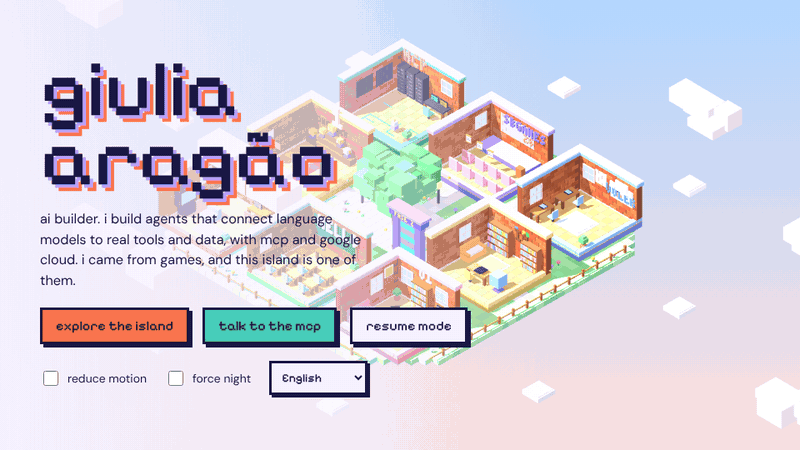
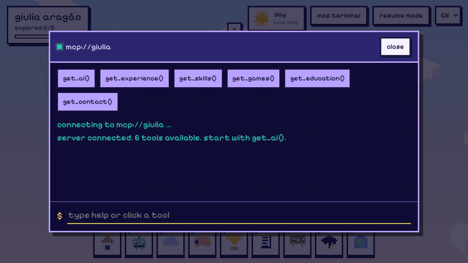
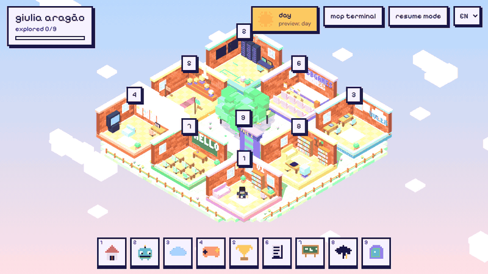
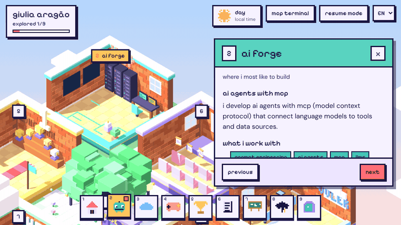

<h1 align="center">game-portfolio</h1>

<p align="center">
  an ai builder's portfolio, built as a tiny isometric island you can walk around.<br>
  nine rooms, one voxel giulia, one mcp terminal, four languages.
</p>

<p align="center">
  
</p>

---

## what is this repository

this is the source of my personal portfolio and resume, written as a small game world instead of a page of bullet points.

i work with ai agents, mcp and google cloud, and i came into tech through game design. the island puts both sides in one place: every room on it is a chapter of my story, and the whole thing is one self-contained `index.html` that you can open in a browser, host anywhere, or fork and make your own.

there is no build step, no framework and no backend. the 3d world is generated in code, voxel by voxel, with [three.js](https://threejs.org).

## the island

the island has nine stops. click a house, press the numbers `1` to `9`, or use the arrow keys.

| # | room | what is inside |
|---|------|----------------|
| 1 | home | who i am and how i work |
| 2 | ai forge | agents, mcp, llms, prompt engineering, data analysis with ai |
| 3 | voler cloud | my current role as ai & cloud engineer on google cloud |
| 4 | patuvê studio | product owner work at an indie game studio |
| 5 | game jams | educajam and global game jam, both first places |
| 6 | sbgames 2026 | three papers presented and published |
| 7 | classroom | teaching programming and creative engineering |
| 8 | education | unifacisa, google student ambassador, google launchpad |
| 9 | stage 2 | where i want to go next, and how to reach me |

each room you visit lights up a floating tile around the island, so the little progress bar in the corner is also a map of where you have been.

## things worth poking at

<table>
  <tr>
    <td width="50%" valign="top">
      
      <b>talk to the mcp</b><br>
      a fake mcp server lives inside the page. each section of my resume is exposed as a tool, like <code>get_ai()</code> or <code>get_experience()</code>. type <code>help</code> to list them, or try <code>sudo hire giulia</code>.
    </td>
    <td width="50%" valign="top">
      
      <b>time of day</b><br>
      the sky follows your local time: dawn, day, dusk and night, with lit windows and fireflies after dark. the button in the corner lets you preview the other times.
    </td>
  </tr>
  <tr>
    <td width="50%" valign="top">
      
      <b>four languages</b><br>
      english, portuguese, spanish and italian. the page picks one from your browser and remembers your choice. everything switches, including the terminal and the resume.
    </td>
    <td width="50%" valign="top">
      <b>resume mode</b><br>
      not in the mood for a game? one button opens a plain, readable resume with the same content as my pdf, in the language you selected. keyboard friendly and printable.
      <br><br>
      <b>reduced motion</b><br>
      the page respects <code>prefers-reduced-motion</code>, and there is a switch on the title screen as well.
    </td>
  </tr>
</table>

## run it

it is a single file, so any of these work:

```bash
# just open it
open index.html

# or serve it locally
python3 -m http.server 8000
# then visit http://localhost:8000
```

the page loads three.js from a cdn (`three@0.150.1`), so you need an internet connection the first time. if the 3d engine cannot load, resume mode still works.

to host it, push to github and turn on pages for the `main` branch. nothing else is needed.

## how it is built

- **voxels in code.** every house, desk, trophy and tree is made from boxes merged into one geometry per object, with vertex colors and a little brightness jitter so the surfaces do not look flat.
- **orthographic isometric camera.** the camera sits at the classic 45 degrees and slides and zooms to each room. when a side panel opens, the view is shifted so the room stays centered in the free space.
- **lighting.** a hemisphere light and a sun with soft shadows. windows, screens and leds are emissive, so they glow at night.
- **the character.** a voxel figure made of separate parts, so the legs and arms swing when she hops between rooms.
- **text in the world.** signs and chalkboards use a tiny 3x5 pixel font turned into voxels.
- **everything else is plain html and css.** the hud, panels, terminal and resume are regular dom elements, so they stay sharp, selectable and accessible.

### stack

| area | choice |
|------|--------|
| 3d | three.js r150 |
| ui | html, css, vanilla javascript |
| fonts | pixelify sans, dm sans |
| build tools | none |

## accessibility

- every interactive element is a real button or link with a visible keyboard focus
- full keyboard navigation: numbers, arrow keys, `esc` to close
- screen reader labels on the room bar, panels and controls, translated with the rest of the page
- reduced motion support
- resume mode as a no-3d fallback

## project layout

```
game-portfolio/
  index.html    the whole portfolio: markup, styles, scene and content
  assets/       gifs used in this readme
  README.md
```

## credits

- the isometric island direction was inspired by [juneberry island](https://pinpal.org/june). all code, scenes, characters and content here are my own.
- fonts: [pixelify sans](https://fonts.google.com/specimen/Pixelify+Sans) and [dm sans](https://fonts.google.com/specimen/DM+Sans), both under the sil open font license.
- 3d: [three.js](https://threejs.org), mit license.

## say hi

- linkedin: [linkedin.com/in/devsgiulia](https://www.linkedin.com/in/devsgiulia/)
- github: [github.com/gisolinha](https://github.com/gisolinha)

---

<p align="center">made by giulia aragão, in paraíba, brazil.</p>
